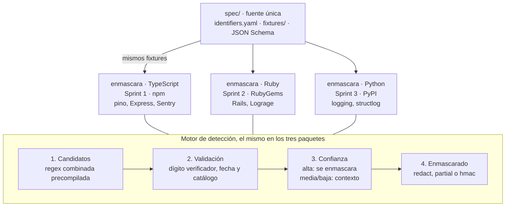

# Enmascara — Plan del Sprint 1 (MVP)

22 de octubre de 2026

## Resumen

El Sprint 1 dura 2 semanas y termina con `enmascara@0.1.0` publicado en npm: detección validada por dígito verificador de CLABE, CURP, RFC y tarjetas, tres estrategias de enmascarado e integraciones con pino, Express y Sentry.

Enmascara es una librería de software libre que encuentra y enmascara identificadores mexicanos en logs, errores y exports. Su diferenciador es validar cada coincidencia matemáticamente, no solo por patrón, para tener muy pocos falsos positivos. Ruby y Python llegan en los sprints 2 y 3 sobre la misma especificación compartida.

**Definición de terminado del sprint:** paquete publicado con provenance, 100 % de los fixtures de la spec en verde, benchmark publicado en el README y un ejemplo funcional por integración.

## Nombre e identidad

La librería se llama **Enmascara** y se publica como `enmascara`, libre con el nombre limpio en npm, PyPI y crates.io. La identidad juega con la lucha libre: en el ring, perder la máscara es la peor derrota, y la librería existe para que ningún dato la pierda.

**Lema:** "Ningún dato pierde la máscara."

| Registro | `enmascara` | Paquetes de integración |
| --- | --- | --- |
| npm | Libre | `enmascara-pino`, `enmascara-express`, `enmascara-sentry` libres |
| PyPI | Libre | No aplica en el Sprint 1 |
| crates.io | Libre | No aplica en el Sprint 1 |
| RubyGems | Sin gema con ese nombre en búsquedas; confirmar con `gem search -r enmascara` | No aplica en el Sprint 1 |

Se descartaron `velo` (ocupado en todos los registros y en conflicto con Velo Payments y Velo de Wix) y `tapadera` (libre, pero en México también significa encubrir algo).

### La lucha libre en la marca

La API se queda en inglés para que cualquier equipo la adopte; la lucha libre vive en la documentación, el sitio y la mascota.

| Estrategia | En la API | En la documentación |
| --- | --- | --- |
| Ocultar todo | `redact` | Máscara completa |
| Mostrar los últimos caracteres | `partial` | Media máscara |
| Identificador correlacionable | `hmac` | Incógnito: misma máscara, mismo luchador |

- **Mascota:** un luchador original, sin parecido a luchadores reales ni logos de empresas de lucha.
- **README:** sección "Rudos y técnicos" para explicar falsos positivos frente a detecciones válidas.
- **Sitio:** el playground se llama "el ring".
- **CLI futuro:** `enmascara revisa` para escanear archivos y bases de datos.

Pendientes antes del primer commit:

- [ ] Reservar `enmascara` y los paquetes de integración en npm, y `enmascara` en PyPI y RubyGems con una versión 0.0.0
- [ ] Crear la organización en GitHub y el repo
- [ ] Registrar dominio para el sitio de documentación
- [ ] Diseñar la mascota y el logo

Disponibilidad verificada el 22 de octubre de 2026 contra las APIs de npm, PyPI y crates.io; RubyGems por búsqueda web.

## Alcance del MVP

El Sprint 1 cubre los cuatro identificadores que tienen dígito verificador y por lo tanto dan alta confianza; NSS, INE y teléfonos, que necesitan contexto para no generar ruido, pasan al Sprint 3.

| Identificador | Formato | Validación | Confianza | Sprint |
| --- | --- | --- | --- | --- |
| CLABE | 18 dígitos | Pesos 3-7-1 sobre 17 dígitos + código de banco en catálogo | Alta | 1 |
| CURP | 18 caracteres | Dígito verificador + fecha válida + entidad válida | Alta | 1 |
| RFC | 12 (moral) / 13 (física) | Homoclave mod 11 + fecha válida; RFC genéricos en lista de permitidos | Alta | 1 |
| Tarjeta | 15 o 16 dígitos, con o sin separadores | Luhn + prefijo de red | Alta | 1 |
| NSS | 11 dígitos | Luhn + palabras de contexto | Media | 3 |
| Clave de elector | 18 caracteres | Patrón + fecha embebida | Media | 3 |
| Teléfono MX | 10 dígitos, opcional +52 | Patrón + palabras de contexto | Baja | 3 |

### Estrategias de enmascarado

| Estrategia | Salida de ejemplo | Para qué sirve |
| --- | --- | --- |
| `redact` | `[CURP]` | Valor por omisión; no deja nada del dato |
| `partial` | `**************0008` | Que soporte reconozca la cuenta sin verla completa |
| `hmac` | `[CURP:7b21e0]` | Correlacionar al mismo usuario entre errores sin exponerlo |

`partial` usa reglas por tipo. En CURP y RFC nunca muestra las posiciones 5 a 10 porque contienen la fecha de nacimiento; para esos tipos solo se permite mostrar las últimas 2 posiciones o caer a `redact`.

### Fuera del Sprint 1

Ruby y Python, NSS, INE, teléfonos, el CLI de escaneo y otros países (CPF, RUT, DNI). Todo eso se apoya en la misma spec, así que no requiere rediseño.

## Arquitectura

Una especificación en YAML es la única fuente de verdad: define patrones, validadores y fixtures, y cada paquete (TypeScript ahora, Ruby y Python después) la implementa y se prueba contra ella.



Falla cerrada: si un validador lanza un error, el candidato se enmascara igual.

Un cambio de comportamiento siempre empieza en la spec con un fixture nuevo; cada paquete falla en CI hasta que lo implementa.

### Estructura del repositorio

```text
enmascara/
├── spec/
│   ├── identifiers.yaml      # patrones, validador, confianza y máscara por tipo
│   ├── schema.json           # JSON Schema que valida identifiers.yaml
│   ├── banks.yaml            # catálogo de códigos de banco para CLABE
│   └── fixtures/             # clabe.yaml, curp.yaml, rfc.yaml, card.yaml
├── packages/
│   ├── core/                 # enmascara: validators/, detect/, strategies/
│   ├── pino/                 # enmascara-pino
│   ├── express/              # enmascara-express
│   └── sentry/               # enmascara-sentry
├── examples/                 # un ejemplo ejecutable por integración
├── bench/                    # corpus sintético y benchmarks
├── docs/sprint-1.md
├── CLAUDE.md
└── SECURITY.md
```

### Forma de la spec

```yaml
clabe:
  pattern: '\b\d{18}\b'
  validator: clabe_checksum
  confidence: high
  mask:
    partial: { keep_last: 4 }
curp:
  pattern: '\b[A-Z]{4}\d{6}[HMX][A-Z]{5}[A-Z0-9]\d\b'
  validator: curp_checksum
  confidence: high
  mask:
    partial: { keep_last: 2 }
```

El nombre del validador es un contrato: cada lenguaje implementa una función con ese nombre y la spec no contiene código.

### API pública

```ts
import { createRedactor } from "enmascara";

const redact = createRedactor({
  detect: ["clabe", "curp", "rfc", "card"],
  strategy: { default: "redact", clabe: "partial", curp: "hmac" },
  hmacKey: process.env.ENMASCARA_HMAC_KEY,
});

redact.text("SPEI a 002180700000000008 de GODE561231HDFRRN04");
redact.object(payload);
redact.findings(text);
```

`redact.object()` devuelve una copia profunda enmascarada y no muta el original. `redact.findings()` devuelve `[{ type, start, end, confidence }]` sin enmascarar. Los valores del ejemplo son ilustrativos; los fixtures reales se generan con los algoritmos de cada validador.

### Decisiones

- **Implementaciones nativas, no un núcleo Rust con bindings.** Evita compilar binarios por plataforma, que frena la adopción; Rust se reserva para el CLI.
- **`findings()` público.** Permite auditar qué detecta Enmascara sin enmascarar, útil para ajustar la configuración y para el futuro escáner.
- **`object()` no muta.** Un logger que modifica el objeto original rompe el código de negocio que lo sigue usando.

## Tecnologías

TypeScript estricto sin dependencias de runtime, en un monorepo con pnpm; las herramientas de los otros lenguajes se fijan ahora para que la spec ya contemple cómo la van a consumir.

| Área | Elección | Motivo |
| --- | --- | --- |
| Lenguaje núcleo | TypeScript 5, `strict`, salida ESM + CJS | Mayor base de usuarios para el primer lanzamiento |
| Monorepo | pnpm workspaces | Paquetes separados por integración sin duplicar el núcleo |
| Build | tsup | Doble salida ESM/CJS y tipos en un paso |
| Tests | Vitest + fast-check | Unitarios contra fixtures y pruebas basadas en propiedades |
| Benchmarks | tinybench | MB/s publicables en el README |
| Spec | YAML en `spec/`, validado con JSON Schema | Una sola fuente para los tres lenguajes |
| Lint y formato | Biome | Una herramienta en vez de ESLint + Prettier |
| Versionado | Changesets | Changelog y versiones por paquete |
| CI | GitHub Actions | Tests, benchmarks, fuzzing y publicación con provenance |
| Docs y playground | Astro Starlight + el núcleo compilado para el navegador | El playground corre local: nada de lo que se pega sale del navegador |
| Ruby (Sprint 2) | Gema pura, RSpec, integración con Rails y Lograge | Sin extensiones nativas para no frenar la adopción |
| Python (Sprint 3) | Paquete puro, pytest, uv, `logging.Filter` y structlog | Mismo criterio |
| CLI (posterior) | Rust | Escaneo de archivos y bases de datos a alta velocidad |

### Paquetes npm del Sprint 1

- `enmascara`: núcleo de detección y enmascarado
- `enmascara-pino`: formatter para pino
- `enmascara-express`: middleware que limpia `req.body`, `query` y headers en logs
- `enmascara-sentry`: función lista para `beforeSend` y `beforeBreadcrumb`

Pino, Express y Sentry son `peerDependencies` de sus paquetes; el núcleo no depende de nada.

## Seguridad y rendimiento

Enmascara procesa datos sensibles, así que la confianza es el producto: cero red, cero dependencias y regex que no se puedan explotar con entradas maliciosas.

### Seguridad

- **Cero red y cero telemetría** en todos los paquetes; un test de CI falla si el bundle importa `http`, `net` o `fetch`.
- **Sin ReDoS:** solo regex sin retroceso catastrófico, revisadas con `recheck` en CI, y fuzzing con fast-check sobre entradas de hasta 1 MB.
- **Llave HMAC** recibida por configuración, nunca con valor por omisión; si la estrategia es `hmac` y no hay llave, la librería lanza un error al crear el redactor, no al primer log.
- **Falla cerrada:** si un validador lanza una excepción, el candidato se enmascara de todos modos.
- **Cadena de suministro:** publicación con `npm publish --provenance` desde GitHub Actions, 2FA obligatorio en npm, Dependabot y OpenSSF Scorecard.
- **Política:** `SECURITY.md` con correo de reporte privado y GitHub Security Advisories habilitado.

### Modelo de amenazas

Cada amenaza tiene un blindaje y un test que lo demuestra; ninguna se da por resuelta sin ese test.

| Amenaza | Cómo ocurriría | Blindaje | Test que lo prueba |
| --- | --- | --- | --- |
| Evasión por Unicode | Dígitos de ancho completo (００２…), espacios de ancho cero o guiones entre dígitos ocultan una CLABE | Normalización NFKC y eliminación de caracteres invisibles antes de detectar; separadores comunes tolerados en el patrón | Fixtures de evasión por cada tipo |
| ReDoS | Una entrada diseñada hace que una regex tarde segundos y bloquee el proceso | Solo regex lineales; análisis con `recheck` en CI | Fuzzing con entradas de 1 MB y límite de tiempo |
| Entradas gigantes | Un log de cientos de MB agota memoria | Tamaño máximo configurable; lo que exceda se enmascara completo | Test con entrada sobre el límite |
| Contaminación de prototipo | Claves como `__proto__` o `constructor` en `redact.object()` | La copia se construye con objetos sin prototipo y solo propiedades propias | Fixtures con claves peligrosas |
| Efectos secundarios al recorrer | Getters o proxies que ejecutan código al leerse | Solo se leen propiedades de datos; los accesores se omiten | Test con getter que lanzaría error |
| Ciclos y profundidad | Objetos circulares o anidados miles de niveles | Detección de ciclos y límite de profundidad | Test con estructura circular |
| Fuga por errores | Un mensaje de excepción incluye el dato que se estaba validando | Los errores nunca incluyen el valor; solo tipo y posición | Test que inspecciona cada mensaje de error |
| Llave HMAC débil | Una llave corta permite adivinar CURP por fuerza bruta | Llave mínima de 32 bytes, verificada al crear el redactor | Test que rechaza llaves cortas |
| Mutación del original | El logger modifica el objeto que el negocio sigue usando | `redact.object()` siempre devuelve una copia | Test que compara el original antes y después |
| Cadena de suministro | Una dependencia o acción de CI comprometida | Cero dependencias de runtime, lockfile congelado, acciones fijadas por SHA, sin scripts `postinstall`, provenance | Scorecard en CI |

La llave HMAC mínima de 32 bytes importa porque una CURP tiene estructura predecible: con una llave débil, el hash se puede revertir probando combinaciones.

### Rendimiento

- Una sola regex combinada y precompilada por redactor; los validadores solo corren sobre candidatos.
- `redact.object()` recorre objetos de forma iterativa, con límite de profundidad y detección de ciclos.
- Ruta rápida: si el texto tiene menos de 6 dígitos en total, se devuelve sin tocar (todo identificador del MVP lleva al menos 6, incluidas las tarjetas escritas con espacios).
- Meta del Sprint 1: medir y publicar MB/s sobre un corpus de logs sintéticos; el umbral de regresión en CI se fija con la primera medición.

## Estándares de ingeniería

Cada lenguaje sigue una guía de estilo pública y la hace cumplir una herramienta en CI: ningún PR entra con advertencias, y ninguna regla depende de la memoria de quien revisa.

### Guía de estilo por lenguaje

| Lenguaje | Guía | Herramientas que la imponen |
| --- | --- | --- |
| TypeScript | [Google TypeScript Style Guide](https://google.github.io/styleguide/tsguide.html) | Biome en modo estricto (`noExplicitAny`, `noNonNullAssertion`, `useNamingConvention`), `tsc --strict` con `noUncheckedIndexedAccess` |
| Ruby | [The Ruby Style Guide](https://rubystyle.guide) | RuboCop con `rubocop-rspec` y `rubocop-performance` |
| Python | [PEP 8](https://peps.python.org/pep-0008/) | Ruff (lint y formato) y mypy en modo `strict` |
| Rust | [Rust API Guidelines](https://rust-lang.github.io/api-guidelines/) | rustfmt y Clippy con `pedantic` |

### Arquitectura y patrones

El núcleo sigue una arquitectura de puertos y adaptadores: el dominio (validar y enmascarar) no conoce pino, Express ni Sentry; las integraciones son adaptadores que dependen del núcleo, nunca al revés.

| Patrón | Dónde se usa | Por qué |
| --- | --- | --- |
| Strategy | `redact`, `partial`, `hmac` | Las estrategias son intercambiables sin tocar el motor |
| Registry | Validadores por tipo de identificador | Agregar un país es registrar validadores, no editar el motor |
| Pipeline | Candidatos → validación → confianza → enmascarado | Cada etapa se prueba aislada |
| Factory | `createRedactor()` | Toda la configuración se valida una sola vez, al crear |
| Adapter | `enmascara-pino`, `-express`, `-sentry` | El núcleo no depende de librerías de terceros |
| Value Object | `Finding` (tipo, posición, confianza) | Inmutable; nunca guarda el valor original |

### Principios SOLID aplicados

- **Responsabilidad única:** un validador solo valida un tipo; una estrategia solo enmascara; el motor solo orquesta.
- **Abierto/cerrado:** un identificador nuevo se agrega con su entrada en la spec y su validador, sin modificar el motor.
- **Sustitución de Liskov:** cualquier estrategia funciona donde se espera otra; los tests de contrato corren contra todas.
- **Segregación de interfaces:** interfaces pequeñas, por ejemplo `IdentifierValidator` con solo `isValid(candidate)` y `MaskingStrategy` con solo `mask(finding)`.
- **Inversión de dependencias:** el motor recibe validadores y estrategias como abstracciones; los adaptadores dependen del núcleo.

### Clean code

- Funciones cortas con un solo nivel de abstracción; sin parámetros booleanos que cambien el comportamiento.
- Sin números mágicos: `CLABE_CHECK_WEIGHTS`, `MINIMUM_HMAC_KEY_BYTES`.
- Inmutabilidad por omisión: `readonly` en TypeScript, objetos congelados en Ruby, `frozen` dataclasses en Python.
- Errores tipados (`InvalidConfigurationError`), nunca cadenas sueltas ni `null` como señal de fallo.
- Sin código muerto ni código comentado.

### Nombres

Nombres completos y comunes que se lean como prosa: `candidate`, `isValidChecksum`, `maskFinding`, `normalizeInput`. Nada de `cand`, `chk`, `msk` ni verbos poco usuales. Las únicas siglas permitidas son los nombres de dominio que ya son siglas: CLABE, CURP, RFC, NSS, HMAC.

### Sin comentarios en el código

El código se explica con nombres, funciones pequeñas y tests. Si algo necesita un comentario para entenderse, se renombra o se extrae a una función con un nombre que lo diga. El *porqué* de una decisión vive en este documento, en el mensaje de commit o en un ADR dentro de `docs/decisions/`, no en el código.

**Excepción: documentación de la API pública.** Todo lo exportado lleva documentación en el formato estándar de su lenguaje, porque es lo que el usuario ve en el autocompletado y de donde se genera la referencia del sitio: TSDoc en TypeScript, YARD en Ruby, docstrings en Python ([PEP 257](https://peps.python.org/pep-0257/)) y rustdoc en Rust. Describe qué hace, sus parámetros, lo que devuelve, los errores que lanza y un ejemplo de uso; nunca cómo funciona por dentro. Lo interno sigue sin comentarios.

## TDD

No se escribe una línea de código de producción sin un test que falle primero, y el historial de commits lo demuestra.

1. **Rojo:** escribir el test (o el fixture en la spec) que describe el comportamiento; correrlo y ver que falla por la razón esperada.
2. **Verde:** escribir el código mínimo que lo hace pasar.
3. **Refactor:** limpiar nombres, extraer funciones y quitar duplicación con todos los tests en verde.

### Cómo se verifica

- **Commits separados:** cada comportamiento entra con un commit `test:` seguido de uno `feat:` o `fix:`; la revisión del PR rechaza código de producción sin su test previo.
- **Cobertura mínima en CI:** 95 % de líneas y ramas en el núcleo; los adaptadores se cubren con tests de extremo a extremo.
- **Pruebas de mutación:** Stryker (TypeScript), mutant (Ruby) y mutmut (Python) alteran el código para comprobar que los tests lo detectan; la cobertura sola no prueba que un test verifique algo.
- **Tests de contrato:** la misma suite corre contra cada estrategia y cada validador, para que cumplan su interfaz.
- **Tests basados en propiedades:** fast-check genera CLABE, CURP y RFC válidas e inválidas al azar para encontrar casos que nadie escribió.

## Por qué no todo se resuelve con IA

Enmascara detecta con algoritmos deterministas (regex y dígitos verificadores), no con modelos de IA, y en el desarrollo la IA es una herramienta que propone código, no la que decide si es correcto.

### En el producto

| Criterio | Algoritmo determinista | Modelo de IA |
| --- | --- | --- |
| Privacidad | El dato nunca sale del proceso | Un servicio externo recibiría justo el dato que se quiere proteger |
| Auditabilidad | Misma entrada, misma salida; se explica por qué se detectó algo | Resultado probabilístico; un falso negativo no tiene explicación |
| Exactitud en identificadores | Un dígito verificador confirma matemáticamente una CLABE | Un modelo puede "parecer" acertar sin validar nada |
| Rendimiento | Microsegundos por línea de log | Órdenes de magnitud más lento y con costo por llamada |
| Operación | Sin red, sin dependencias, funciona sin conexión | Requiere red o un modelo pesado embebido |

La IA sí tendría sentido para datos sin estructura, como nombres o direcciones en texto libre. Queda fuera del MVP y, si llega, será opcional, local y nunca la ruta por omisión.

### En el proceso

- Claude Code propone código; lo que decide si entra son los tests, el linter, las pruebas de mutación y la revisión humana.
- Ningún cambio se acepta si quien lo aprueba no puede explicarlo línea por línea.
- Los algoritmos de validación (CLABE, CURP, RFC, Luhn) se verifican contra fuentes oficiales y fixtures, no contra lo que un modelo "recuerda".
- Las decisiones de arquitectura y seguridad se documentan como ADR escritos y revisados por una persona.

## Plan de acción

Nueve historias en 2 semanas: la semana 1 deja la spec y el núcleo validados; la semana 2 añade integraciones, seguridad en CI y la publicación.

| # | Historia | Semana | Puntos | Criterios de aceptación |
| --- | --- | --- | --- | --- |
| 1 | Monorepo y CI base | 1 | 2 | pnpm, tsup, Vitest y Biome estricto configurados; CI corre lint, tests, cobertura mínima de 95 % y pruebas de mutación en cada PR |
| 2 | Spec y fixtures | 1 | 3 | `identifiers.yaml` validado por JSON Schema; al menos 30 válidos, 30 inválidos y 20 falsos positivos conocidos por tipo |
| 3 | Validadores CLABE y tarjeta | 1 | 2 | Pasan todos sus fixtures; CLABE verifica código de banco contra catálogo |
| 4 | Validadores CURP y RFC | 1 | 3 | Pasan todos sus fixtures; fechas imposibles rechazadas; RFC genéricos ignorados |
| 5 | Motor de detección | 1 | 3 | Regex combinada, validación por candidato, `redact.text()` y `redact.object()` con límite de profundidad y ciclos |
| 6 | Estrategias de enmascarado | 2 | 2 | `redact`, `partial` con reglas por tipo y `hmac`; `hmac` sin llave falla al crear el redactor |
| 7 | Integraciones pino, Express y Sentry | 2 | 3 | Un ejemplo ejecutable por integración en `examples/`; tests de extremo a extremo |
| 8 | Seguridad en CI | 2 | 2 | Chequeo ReDoS, fuzzing, test de cero imports de red, Scorecard y `SECURITY.md` |
| 9 | Benchmarks, README y publicación 0.1.0 | 2 | 2 | MB/s en el README; paquetes publicados con provenance desde CI |

Total: 22 puntos. Si el sprint se aprieta, la historia 7 se recorta a pino y Sentry, y Express pasa al Sprint 2.

### Después del Sprint 1

- **Sprint 2:** gema de Ruby con integración Rails y Lograge; playground en el sitio de docs.
- **Sprint 3:** paquete de Python; NSS, INE y teléfonos con puntaje de contexto.
- **Sprint 4:** CLI de escaneo en Rust y primer país adicional.

## Distribución y lanzamiento

Enmascara se distribuye por los registros de cada lenguaje bajo licencia MIT, y se da a conocer con un artículo técnico que muestre un problema real antes que la librería.

### Canales de publicación

| Canal | Qué se publica | Cuándo |
| --- | --- | --- |
| npm | `enmascara` y paquetes de integración | Sprint 1 |
| RubyGems | Gema `enmascara` | Sprint 2 |
| PyPI | Paquete `enmascara` | Sprint 3 |
| GitHub Releases | Binarios del CLI firmados con Sigstore | Sprint 4 |
| Sitio de docs | Guías, referencia de API y playground local | Sprint 2 |

**Licencia:** MIT. Es la que menos fricción genera en los departamentos legales de las empresas, que son quienes después patrocinan.

### Lanzamiento

1. Artículo técnico: por qué un enmascarado parcial de CURP filtra la fecha de nacimiento, con ejemplos reales de logs.
2. Publicación en comunidades de desarrolladores en México y Latinoamérica, y en Hacker News con el artículo, no con el repo.
3. Contacto directo con equipos de ingeniería de fintechs para que lo prueben y den retroalimentación antes de la 1.0.
4. Charla corta en meetups locales de Node.js y Ruby.

### Señales de éxito a 90 días

Descargas semanales en npm, estrellas en GitHub, issues abiertos por usuarios externos y al menos una empresa usando Enmascara en producción. Las metas numéricas se fijan después del primer mes con datos reales.

## Financiamiento

Donaciones desde el día uno con GitHub Sponsors y Open Collective; el ingreso sostenible llega después con el escáner de datos en reposo como producto de pago.

| Fuente | Qué recibe quien paga | Cuándo |
| --- | --- | --- |
| GitHub Sponsors (individual) | Agradecimiento en el README | Sprint 1 |
| Open Collective (empresas) | Logo en README y sitio; gastos transparentes | Sprint 1 |
| Soporte e integración | Horas de consultoría para adoptar Enmascara | Tras la 1.0 |
| Escáner hospedado (open-core) | Reportes de PII en bases de datos y buckets para auditorías | Tras el CLI |

La librería siempre será libre y completa. Lo de pago es lo que una empresa necesita para cumplimiento, no para enmascarar sus logs.

## Handoff a Claude Code

Claude Code trabaja historia por historia en el orden del plan, con un PR por historia; la spec y los fixtures van primero porque todo lo demás se prueba contra ellos.

Antes de abrir Claude Code:

- [x] Crear el repo en GitHub y clonarlo
- [x] Agregar este documento al repo como `docs/sprint-1.md`
- [x] Crear `CLAUDE.md` en la raíz del repo

### Prompt inicial

```text
Lee docs/sprint-1.md y CLAUDE.md. Vamos a trabajar el Sprint 1 historia por historia.
Sigue TDD en todo: test que falla, código mínimo, refactor, con commits separados.
Empieza con la historia 1 (monorepo y CI base). Antes de escribir código, muéstrame la
estructura de carpetas y los archivos de configuración que vas a crear. Cuando la apruebe,
impleméntala, corre lint y tests, y prepara el PR. No avances a la historia 2 sin mi visto bueno.
```
