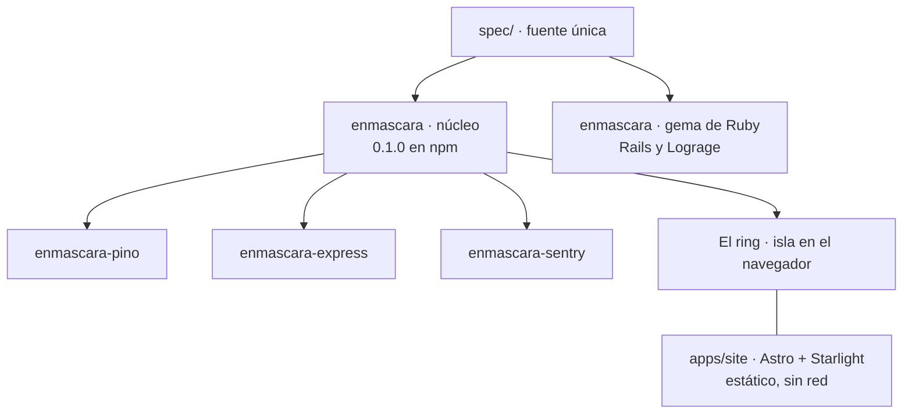

# Enmascara — Plan del Sprint 2

13 de noviembre de 2026

## Resumen

El Sprint 2 dura 2 semanas, del 16 al 27 de noviembre de 2026, y termina con `enmascara-pino`, `enmascara-express` y `enmascara-sentry` publicados en npm con provenance y la base del sitio en `apps/site` con sus controles de calidad en verde. Primero cierra lo que quedó pendiente del Sprint 1.

El backlog completo (integraciones, sitio y gema de Ruby) suma 51 puntos. El Sprint 1 entregó 19 puntos en 16 días hábiles, así que la capacidad real es de unos 12 puntos por sprint. El Sprint 2 se compromete a 12 puntos. El resto se reparte entre los sprints 3 a 6 sin recortar ningún criterio de calidad. La sección [Qué pasa a los sprints siguientes](#qué-pasa-a-los-sprints-siguientes) explica el orden.

**Definición de terminado del sprint:** los tres paquetes de integración publicados con provenance; un ejemplo ejecutable por integración que corre en CI; cobertura de 95 % y pruebas de mutación en verde en cada paquete nuevo; `apps/site` construye en CI con axe sin violaciones, Lighthouse de 95 o más y cero peticiones a otros orígenes; el cierre del Sprint 1 queda registrado en `docs/sprint-1.md`.

Siguen vigentes, sin cambios, las secciones Estándares de ingeniería, TDD, Modelo de amenazas y Por qué no todo se resuelve con IA de `docs/sprint-1.md`. Este documento solo agrega lo nuevo.

## Cierre del Sprint 1

El núcleo se publicó como `enmascara@0.1.0` con provenance el 13 de noviembre. Las ocho historias del alcance ajustado quedaron completas; la historia 7, de las nueve originales, pasa a este sprint. La definición de terminado se cumplió en tres de sus cuatro puntos: falta el ejemplo por integración, porque las integraciones se movieron a este sprint.

### Historias

| # | Historia | Puntos | Estado | Evidencia |
| --- | --- | --- | --- | --- |
| 1 | Monorepo y CI base | 2 | Completa | `ci.yml`: lint, typecheck, cobertura con umbral de 95 % y Stryker en cada PR (PR #1) |
| 2 | Spec y fixtures | 3 | Completa | Todos los tipos tienen al menos 30 válidos, 30 inválidos y 20 lookalikes; JSON Schema por archivo; ADR 0001 y 0002 (PR #2) |
| 3 | Validadores CLABE y tarjeta | 2 | Completa | Catálogo de bancos de Banxico y de redes con fuentes; ADR 0003 (PR #3) |
| 4 | Validadores CURP y RFC | 3 | Completa | Fechas imposibles rechazadas, RFC genéricos en allowlist (PR #4) |
| 5 | Motor de detección | 3 | Completa | `text()`, `object()` y `findings()` con límites, ciclos y profundidad; ADR 0004 (PR #5) |
| 6 | Estrategias de enmascarado | 2 | Completa | `redact`, `partial` y `hmac` con HMAC-SHA256 propio verificado contra FIPS 180-4 y RFC 4231; ADR 0005 (PR #6) |
| 7 | Integraciones pino, Express y Sentry | 3 | **Pendiente** | Movida al Sprint 2 el 30 de octubre; no existen `packages/pino`, `packages/express`, `packages/sentry` ni `examples/` |
| 8 | Seguridad en CI | 2 | Completa | `recheck`, fuzzing de 1 MiB, test de cero imports de red, Scorecard, Dependabot y `SECURITY.md` (PR #7) |
| 9 | Benchmarks, README y publicación 0.1.0 | 2 | Completa | Tabla de MB/s sincronizada con `bench/results.json`, pisos en CI, trusted publishing; ADR 0006 (PR #12 a #16) |

Comprometido: 19 puntos. Entregado: 19 puntos sin la historia 7.

### Definición de terminado

| Criterio | Estado | Evidencia |
| --- | --- | --- |
| 0.1.0 publicado con provenance | Cumplido | `npm view enmascara@0.1.0` reporta una atestación `https://slsa.dev/provenance/v1`; `release.yml` la exige antes de crear la etiqueta `enmascara@0.1.0` |
| 100 % de los fixtures en verde | Cumplido | 54 archivos y 698 tests en verde en local y en CI el 13 de noviembre |
| Benchmark publicado en el README | Cumplido | Sección Rendimiento con 4 escenarios; un test falla si la tabla no coincide con `bench/results.json` |
| Un ejemplo funcional por integración | **No cumplido** | No hay paquetes de integración. El ajuste del 30 de octubre lo dejó fuera, pero la definición de terminado no se actualizó |

### Otros pendientes del Sprint 1

| Pendiente | Estado | Efecto |
| --- | --- | --- |
| Reservar `enmascara-pino`, `enmascara-express` y `enmascara-sentry` en npm | No reservados (npm responde 404) | **Bloquea la historia 4**: trusted publishing solo se configura sobre un paquete que ya existe (ADR 0006) |
| Reservar `enmascara` en PyPI y RubyGems | No reservados (ambos responden 404) | Riesgo de que alguien ocupe el nombre antes de los sprints de Ruby y Python |
| GitHub Sponsors y Open Collective | Sin cuentas ni `.github/FUNDING.yml` | El plan los ponía desde el Sprint 1; bloquea los enlaces de Patrocina |
| Dominio del sitio | Sin registrar en el repositorio | Bloquea la publicación del sitio (historia 11) |
| Mascota | No hay diseño | El handoff solo trae el logo de la máscara. No bloquea ninguna historia |
| Correo de reporte privado en `SECURITY.md` | Solo GitHub Security Advisories | El plan pedía ambos. Coincide con el marcador `[correo de contacto]` del diseño |
| Fechas reales | La extensión llegaba al 7 de noviembre; la 0.1.0 salió el 13 | Cuatro días hábiles más que no quedaron registrados en `docs/sprint-1.md` |
| Sección Sitio web de `CLAUDE.md` | Cambio local sin commit | Se commitea junto con este plan |
| PRs de Dependabot #8 y #18 | Abiertos | Mantenimiento; se revisan el primer día |

### Lecciones para estimar

- **Velocidad real: 12 puntos por sprint.** 19 puntos en 16 días hábiles (del 23 de octubre al 13 de noviembre). La investigación de fuentes oficiales hizo crecer las historias 2 y 3, y la publicación (historia 9) necesitó tres PRs extra para el rendimiento ASCII, los pisos del benchmark y la verificación de provenance.
- **Las historias de 2 y 3 puntos se cumplieron cuando el alcance estaba cerrado.** Las que dependían de decisiones (fuentes, publicación) crecieron. Por eso cada historia nueva con una decisión abierta lleva un ADR en sus criterios.
- **La historia 7 se subestimó.** Con la vara del Sprint 1 (TSDoc con ejemplo, tests de extremo a extremo, mutación, ejemplo en CI y publicación con provenance) son 9 puntos, no 3.

## Alcance

| Bloque | Puntos | Sprint |
| --- | --- | --- |
| Pendiente del Sprint 1: integraciones pino, Express y Sentry | 9 | 2 |
| Sitio en `apps/site`: base | 3 | 2 |
| Sitio: el ring, documentación y referencia de API | 12 | 3 (propuesto) |
| Sitio: landing, patrocina y publicación | 9 | 4 (propuesto) |
| Gema de Ruby con Rails y Lograge | 18 | 4 a 6 (propuesto) |
| **Total** | **51** | |

### Fuera del Sprint 2

El sitio salvo su base, la gema de Ruby, el paquete de Python, NSS, INE, teléfonos y el CLI. Ninguna de esas piezas requiere cambiar la spec.

## Arquitectura

Las integraciones son adaptadores: dependen del núcleo y de su librería (pino, Express o Sentry) como `peerDependencies`, y el núcleo no sabe que existen. El sitio es otro consumidor del núcleo: el ring importa `enmascara` del workspace y nunca reimplementa la detección.



### Estructura del repositorio al cerrar el Sprint 2

```text
enmascara/
├── apps/
│   └── site/                 # Astro + Starlight, salida estática, paquete privado
│       ├── src/styles/tokens.css
│       ├── src/components/
│       ├── src/content/docs/
│       └── test/             # Playwright, axe y tests de componentes
├── packages/
│   ├── core/                 # enmascara
│   ├── pino/                 # enmascara-pino
│   ├── express/              # enmascara-express
│   └── sentry/               # enmascara-sentry
├── examples/
│   ├── pino/
│   ├── express/
│   └── sentry/
├── spec/
├── bench/
└── docs/sprint-1.md, docs/sprint-2.md, docs/decisions/
```

La gema de Ruby vivirá en `ruby/` con su propio `Gemfile`; la estructura exacta se fija en el ADR de la historia 12.

### Decisiones

- **`enmascara` es `peerDependency` de cada integración.** Así la aplicación controla la versión del núcleo y comparte un solo redactor entre su logger, su middleware y Sentry.
- **El sitio no se publica en npm.** `apps/site` es un paquete privado del workspace; sus dependencias son solo de build y no llegan a ningún paquete publicado.
- **Toda salida de ejemplo en el sitio se genera con el paquete real.** El prototipo del diseño calcula sus propios resultados; el sitio no copia ninguno.

## Diferencias entre el diseño y el paquete

El handoff del lienzo "Enmascara — Landing" es la referencia visual, pero su código de ejemplo no es la librería. Se corrió `enmascara@0.1.0` con los textos del diseño. Estas diferencias se resuelven a favor del paquete y quedan en los criterios de las historias:

| Dónde | El diseño dice | El paquete hace | Resolución |
| --- | --- | --- | --- |
| Ring y landing | Filas "Ignorado: no pasó la validación" y "números ignorados" en el resumen | `findings()` solo devuelve hallazgos validados; los candidatos rechazados no salen de la API | Se quitan las filas y el conteo de ignorados (D2) |
| Hero, ring | Etiqueta `[TARJETA]` | `[CARD]` | Se muestra la salida real |
| Hero | Media máscara de tarjeta con espacios: `**** **** **** 1111` | `************1111`, sobre el valor canónico (ADR 0005) | Se muestra la salida real |
| Hero, docs | `[CURP:7b21e0]` | El sufijo depende de la llave | El sitio usa una llave de demostración pública y muestra el resultado que da |
| Docs, paso 3 | `GODE561231HDFRRN04` se enmascara | No pasa el dígito verificador y queda sin enmascarar | Usar un valor válido de los fixtures; cada ejemplo de la documentación se ejecuta en CI |
| Docs, opciones | `maxInputBytes`; `hmacKey: string` | `maxInputLength`, en caracteres; `hmacKey: string \| Uint8Array` | La tabla sale de los tipos reales (historia 8) |
| Landing, `logger.ts` | `pino({ formatters: enmascaraFormatter(redact) })` | Pino no pasa el mensaje por `formatters.log`, y `child()` sin opciones reemplaza `formatters.bindings` por una identidad (pino 9 y 10) | El ejemplo usa `createMaskedLogger(redact, pino, options)` de la historia 1 |
| Landing, "Cómo funciona" | "Una sola expresión regular precompilada" | Una regex por tipo (ADR 0004) | Corregir el texto |
| Landing, "Valida, no adivina" | Toda CURP "se confirma con su dígito verificador" | El algoritmo de CURP no tiene fuente oficial; está verificado con 3 CURP reales (ADR 0002) | La página de CURP lo explica; el texto de la landing se revisa con el equipo |
| Todas las pantallas | Google Fonts por CDN | Prohibido por `CLAUDE.md` | @fontsource autoalojado |
| Docs | Búsqueda en el encabezado | La búsqueda de Starlight (Pagefind) usa WebAssembly, que `default-src 'self'` bloquea | Decisión pendiente D4 |

### Marcadores del diseño

Se dejan visibles y se listan en un issue en la historia 5: `$[monto]` en los tres niveles de Patrocina, `[correo de contacto]`, la respuesta sobre CFDI (`[Por definir según cómo se constituya el proyecto.]`), `[versión mínima de Node.js]` y los enlaces a GitHub Sponsors y Open Collective. Para la versión de Node.js, el issue anota que `packages/core/package.json` declara `"node": ">=22"`, para que el equipo decida si ese es el valor. Las ranuras "[Tu empresa aquí]" son parte del diseño, no marcadores.

## Tecnologías nuevas

| Área | Elección | Motivo |
| --- | --- | --- |
| Integraciones | pino, Express 4 y 5, `@sentry/node` como `peerDependencies` | El núcleo sigue sin dependencias; cada aplicación trae su versión |
| Sitio | Astro + Starlight, salida estática | Fijado en `CLAUDE.md`; Starlight da navegación, tabla de contenido y tema claro u oscuro |
| Tipografías | `@fontsource/anton`, `@fontsource/ibm-plex-sans`, `@fontsource/ibm-plex-mono` | Autoalojadas: la IP del visitante no sale a terceros |
| Tests del sitio | Playwright a 390 y 1440 px, `@axe-core/playwright`, Vitest para componentes | Mobile-first verificado en las dos medidas del diseño |
| Rendimiento del sitio | Lighthouse CI | Mínimo 95 en rendimiento, accesibilidad y buenas prácticas |
| Referencia de API (Sprint 3) | TypeDoc con su integración para Starlight | Se genera de los TSDoc; un export sin documentar rompe el build |
| Ruby (sprints 4 a 6) | RSpec, RuboCop con `rubocop-rspec` y `rubocop-performance`, SimpleCov, mutant, YARD | Las herramientas que fija `docs/sprint-1.md` |

## Seguridad

### Modelo de amenazas: nuevas filas

Cada fila tiene su test; ninguna se da por resuelta sin él. Las filas del Sprint 1 aplican también a las integraciones y a la gema.

| Amenaza | Cómo ocurriría | Blindaje | Test que lo prueba |
| --- | --- | --- | --- |
| Mensaje de log sin enmascarar | `logger.info("SPEI a 0021…")`: pino no pasa `msg` por `formatters.log` | `enmascara-pino` enmascara también el mensaje y los bindings | Test con pino real escribiendo a un stream en memoria |
| Mutación de lo que usa el negocio | El middleware enmascara `req.body` en sitio, o `beforeSend` modifica el evento original | Las integraciones trabajan sobre copias; `req` nunca cambia | Tests que comparan `req` y el evento antes y después |
| Falla abierta en una integración | Una excepción al enmascarar deja pasar la línea o el evento original | Falla cerrada: la línea se reemplaza por `[REDACTED]` y el evento de Sentry se descarta | Test con un redactor que lanza |
| Datos en partes poco obvias del evento | Breadcrumbs, `request.headers`, `extra`, `contexts` o variables de frames de Sentry | `beforeSend` y `beforeBreadcrumb` recorren el evento completo con `redact.object()` | Fixture de evento de Sentry con un identificador en cada campo |
| Exfiltración desde el ring | El ring envía o guarda lo que el usuario pega | Sin `fetch`, sin almacenamiento; CSP `default-src 'self'` | Playwright: escribir, pegar y cambiar opciones no genera ninguna petición ni escribe en storage, cookies o IndexedDB |
| XSS desde la entrada del ring | Pegar `` y que el resultado se interprete como HTML | El resultado se escribe como texto, nunca como HTML | Test con cargas XSS conocidas |
| Rastreo o scripts de terceros | Un plugin, una fuente o un hosting agrega analítica | Solo recursos del mismo origen; sin cookies | Playwright recorre cada página y falla ante cualquier petición a otro origen o cualquier cookie |
| Scripts inyectados | Un script inline o de otro origen | CSP sin `'unsafe-inline'`; hashes generados en el build | Test que escucha `securitypolicyviolation` en cada página |
| Clickjacking | El sitio embebido en un iframe ajeno | `frame-ancestors 'none'` como cabecera (no funciona en `<meta>`) | Test contra las cabeceras del sitio publicado (historia 11) |
| Persistencia no permitida | Algo más que el tema se guarda en el navegador | Solo la preferencia de tema en `localStorage` | Test que inspecciona el storage después de usar cada isla |
| Llave de demostración tomada por real | Alguien copia la llave del ring a producción | La llave se llama de demostración y el ring lo dice al elegir incógnito | Test de que el aviso aparece con `hmac` |

## Estándares

Sin cambios respecto a `docs/sprint-1.md` y `CLAUDE.md`. Para el sitio se agregan los de la sección Sitio web de `CLAUDE.md`: tokens CSS como única fuente de colores, tipografías, espaciados y radios; mobile-first a 390 y 1440 px; JavaScript solo en islas (el ring, el menú móvil, el cambio de tema, las pestañas de instalación y el selector de frecuencia); WCAG 2.2 AA con objetivos táctiles de 44 px.

## Plan de acción

### Compromiso del Sprint 2

Cinco historias, 12 puntos. La semana 1 deja dos integraciones publicables y empieza la tercera; la semana 2 termina Express, publica las tres y monta la base del sitio.

| # | Historia | Semana | Puntos | Criterios de aceptación |
| --- | --- | --- | --- | --- |
| 1 | `enmascara-pino` con ejemplo (pendiente del Sprint 1) | 1 | 2 | `packages/pino` exporta `createMaskedLogger(redact, pino, options, destination)`: recibe la función `pino` de la aplicación, compone sus `formatters.log`, `formatters.bindings`, serializers y `redact`, y enmascara el objeto y sus claves, mixins, errores, el mensaje ya interpolado y los bindings del logger, de sus hijos y de sus descendientes, también los que agregan las opciones de un hijo. Un objeto con `options` no basta: pino no pasa el mensaje por `formatters.log` y `child()` sin opciones ignora `formatters.bindings`. Tests de extremo a extremo con pino 9 y 10 escribiendo a un stream en memoria. Falla cerrada probada. `pino` y `enmascara` como `peerDependencies`. TSDoc con ejemplo en cada export. `examples/pino` corre en CI e imprime líneas enmascaradas. Cobertura de 95 % y mutación en verde. Changeset |
| 2 | `enmascara-sentry` con ejemplo (pendiente del Sprint 1) | 1 | 2 | `packages/sentry` exporta funciones listas para `beforeSend` y `beforeBreadcrumb`. Enmascaran mensajes, valores de excepciones, variables de frames, `request` (datos, query, headers y cookies), `extra`, `contexts`, `user` y breadcrumbs, sobre una copia del evento. Si enmascarar falla, el evento se descarta. Test de extremo a extremo con `@sentry/node` y un transporte falso que no usa la red. `examples/sentry` corre en CI con el mismo transporte. TSDoc, cobertura, mutación y changeset |
| 3 | `enmascara-express` con ejemplo (pendiente del Sprint 1) | 1–2 | 3 | Un ADR fija la forma del middleware antes del código: cómo entrega a pino-http o morgan una vista enmascarada de `req.body`, `req.query`, `req.params` y los headers sin tocar `req`. Test que prueba que `req` no cambia. Tests de extremo a extremo con Express 4 y 5. `examples/express` corre en CI y hace una petición local sin salir del proceso. TSDoc, cobertura, mutación y changeset |
| 4 | Publicación de las integraciones 0.1.0 con provenance (pendiente del Sprint 1) | 2 | 2 | `release.yml` publica cada paquete cuya versión no está en npm, con trusted publishing, y exige la atestación SLSA antes de crear su etiqueta (`enmascara-pino@0.1.0`, etc.). Test de tarball por paquete: solo `dist`, README y LICENSE, y ninguna dependencia de runtime fuera de las `peerDependencies`. El test de cero imports de red cubre los tres bundles. Los ejemplos corren en CI contra los tarballs empacados. Requiere la tarea del equipo T1 |
| 5 | Base del sitio en `apps/site` | 2 | 3 | Astro + Starlight con salida estática en el workspace (`apps/*`). `tokens.css` define una sola vez colores (con tema claro y oscuro de la documentación), tipografías, escala tipográfica, espaciados y radios tomados del diseño; un test falla si un componente o estilo fuera de `tokens.css` contiene un color literal. Anton, IBM Plex Sans e IBM Plex Mono con @fontsource. CSP sin `'unsafe-inline'`, con hashes del build; un ADR registra la decisión D4. Job de CI con build, Playwright a 390 y 1440 px, axe sin violaciones, Lighthouse de 95 o más y el test de cero peticiones a otros orígenes y cero cookies. Biome y `tsc --strict` cubren el sitio y Dependabot lo vigila. Issue con los marcadores del diseño |

Total: 12 puntos.

### Qué pasa a los sprints siguientes

Con 12 puntos por sprint, las 51 del backlog ocupan cinco sprints. La propuesta ordena el trabajo así:

1. **Sprint 2: terminar el producto npm.** Lo pendiente del Sprint 1 va primero, como se pidió, y cierra la definición de terminado que quedó abierta. La base del sitio entra porque sus controles (CSP, axe, Lighthouse, cero peticiones externas) son las vallas contra las que se construye todo lo demás, y porque descubre pronto el riesgo técnico de la CSP con Starlight.
2. **Sprint 3: el ring y la documentación.** El ring es el riesgo técnico más alto del sitio: es la primera vez que el núcleo corre en el navegador como isla, con la regla de cero red verificada por Playwright. La documentación va en el mismo sprint porque las integraciones recién publicadas no se adoptan sin ella. La landing reutiliza la isla del ring, así que va después.
3. **Sprint 4: landing, patrocina y publicación del sitio, y la base de la gema.** Patrocina va al final del sitio porque hoy sería una página de marcadores: no hay montos, ni cuentas de GitHub Sponsors y Open Collective, ni respuesta sobre CFDI. La publicación necesita dominio y hosting (T3). Los 2 puntos de la base de la gema arrancan Ruby sin depender del sitio.
4. **Sprints 5 y 6: la gema de Ruby.** Se publica completa, con Rails y Lograge, al cerrar el Sprint 6.

**Por qué el sitio antes que Ruby.** La 0.1.0 todavía no se anuncia: el plan de lanzamiento (artículo, comunidades, fintechs) necesita documentación y el ring. Lanzar primero el producto npm trae retroalimentación de usuarios reales antes de replicar la API y la spec en un segundo lenguaje; cualquier cambio que salga de ahí costaría el doble con la gema ya publicada.

**Lo que cuesta.** La gema llega cuatro sprints después de lo planeado. Python, NSS, INE y teléfonos dejan el Sprint 3: Python puede empezar en el Sprint 6 y publicarse en el 7. La alternativa era invertir el orden, con la gema en los sprints 3 y 4 y el sitio en los sprints 4 a 6; el 13 de noviembre se decidió sitio primero (D1).

### Propuesta para los sprints 3 a 6

| # | Historia | Sprint | Puntos | Criterios de aceptación |
| --- | --- | --- | --- | --- |
| 6 | El ring | 3 | 5 | Página `/ring` según los tableros "El ring" y "El ring · móvil", y la versión compacta para la landing con la misma isla. Importa `enmascara` del workspace; un test falla si la isla define validadores propios. Ejemplos cargables (log de transferencias, payload JSON y export CSV) con valores tomados de los fixtures de la spec. Selector de tipos, de estrategia (Máscara completa = `redact`, Media máscara = `partial`, Incógnito = `hmac`) y entrada y salida en vivo. Tabla de hallazgos con tipo, línea y resultado, nunca el valor, según D2. Panel "Lo mismo en tu código" generado con las opciones elegidas. Botón de copiar. Aviso de la llave de demostración con `hmac`. En móvil, los ajustes se pliegan como en el diseño. Playwright prueba cero peticiones y cero almacenamiento al usarlo, que funciona sin conexión después de cargar y las cargas XSS. axe y foco visible en cada control |
| 7 | Documentación con el diseño | 3 | 5 | Starlight con el encabezado, la barra lateral, "En esta página", anterior y siguiente, y "Editar esta página en GitHub" de los tableros "Docs · Inicio rápido" y "Docs · móvil". La versión del encabezado sale de `packages/core/package.json`. Tema claro y oscuro, cuya preferencia es lo único que se guarda en `localStorage`. Pestañas de instalación npm, pnpm y yarn, accesibles con teclado. Páginas: Introducción, Instalación, Inicio rápido, CLABE, CURP (con el estado del ADR 0002), RFC, Tarjetas, las tres estrategias, pino, Express, Sentry, Modelo de amenazas y Reportar una vulnerabilidad. "NSS, INE y teléfonos · próximamente" sin enlace. Cada bloque de código con salida esperada (`→`) se ejecuta en CI contra el paquete construido, como el README. Búsqueda según D4 |
| 8 | Referencia de API generada | 3 | 2 | TypeDoc genera la referencia de `enmascara` y de las tres integraciones desde sus TSDoc, dentro de Starlight. El build falla si un export no tiene documentación o si un ejemplo no compila. La tabla de opciones de `createRedactor` del Inicio rápido enlaza a la referencia en vez de repetirla |
| 9 | Landing | 4 | 5 | Tableros "Landing · escritorio" y "Landing · móvil". Navegación con menú móvil accesible: `aria-expanded`, cierra con Esc y devuelve el foco. Hero con copia de `npm install enmascara` y un antes y después generado en el build con el paquete real; un test falla si difiere de lo que produce `redact.text()`. Ring compacto (historia 6). "Cómo funciona" corregido según el ADR 0004. Integraciones con el estado real de Rails y Python. `logger.ts` ejecutado en CI. Lista de espera según D3. Adelanto de Patrocina y pie con la leyenda de privacidad, que respalda el test de cero peticiones externas |
| 10 | Patrocina | 4 | 2 | Tableros "Patrocina" y "Patrocina · móvil". Niveles Aficionado, Esquina y Campeón con `$[monto]` visible. Selector Mensual y Una vez con `aria-pressed`, como isla. Preguntas frecuentes con `<details>`, sin JavaScript. Enlaces a GitHub Sponsors y Open Collective cuando existan (T2); mientras tanto quedan como marcadores en el issue. `[correo de contacto]` visible |
| 11 | Publicación del sitio | 4 | 2 | Despliegue estático desde GitHub Actions en `main`, con acciones fijadas por SHA, al dominio de T3. Cabeceras: CSP, `frame-ancestors 'none'`, `Referrer-Policy: no-referrer`, `Permissions-Policy`, `X-Content-Type-Options` y HSTS. Analítica del hosting desactivada. Un test lee las cabeceras del sitio publicado y Lighthouse CI corre contra la URL de vista previa de cada PR |
| 12 | Gema: base y CI de Ruby | 4 | 2 | Un ADR fija la estructura de `ruby/` y las versiones de Ruby con soporte vigente. Gema `enmascara` sin dependencias de runtime y con `rubygems_mfa_required`. RuboCop sin ofensas, RSpec, SimpleCov con 95 % de líneas y ramas, mutant y YARD sin elementos públicos sin documentar, todo en CI. Los catálogos de la spec se copian a la gema con un test que falla si dejan de coincidir |
| 13 | Gema: validadores CLABE, tarjeta, CURP y RFC | 5 | 3 | Pasan todos los fixtures de `spec/fixtures/`, con pruebas basadas en propiedades. Mismas reglas que el núcleo: catálogo de bancos, redes de tarjeta, fechas imposibles y RFC genéricos |
| 14 | Gema: motor de detección | 5 | 5 | Normalización NFKC con mapa de posiciones, mayúsculas y sin `Default_Ignorable_Code_Point`. `text`, `findings` y `object` con los mismos límites que el ADR 0004. `object` copia solo `Hash`, `Array`, `String`, `Symbol` y números, sin llamar métodos de otros objetos, y los reemplaza por `[REDACTED]`. Ciclos, profundidad y claves enmascaradas. Pasa `spec/fixtures/texts.yaml`. Cada fila del modelo de amenazas tiene su test en RSpec. Errores sin valores |
| 15 | Gema: estrategias de enmascarado | 5 | 2 | `redact`, `partial` y `hmac` reproducen `spec/fixtures/strategies.yaml` byte por byte. HMAC con `OpenSSL::HMAC` de la biblioteca estándar, decisión registrada en un ADR. Llave obligatoria de al menos 32 bytes, validada al crear el redactor |
| 16 | Gema: integración con Rails y Lograge | 6 | 3 | Un ADR decide entre una sola gema con integraciones que se cargan solo si Rails o Lograge están presentes, o gemas separadas. Formatter del logger de Rails y de Lograge que enmascaran cada línea. Tests en las versiones de Rails con soporte vigente. `examples/rails` corre en CI |
| 17 | Gema: seguridad en CI, benchmark y publicación 0.1.0 | 6 | 3 | Test de que la gema no requiere `net/http`, `socket` ni `open-uri`. Fuzzing con entradas de 1 MiB y límite de tiempo. MB/s en el README de la gema con piso en CI. Publicación en RubyGems con trusted publishing y atestación de Sigstore. Requiere T1 |

Totales: Sprint 3, 12 puntos; Sprint 4, 11; Sprint 5, 10; Sprint 6, 6. El Sprint 6 tiene espacio para empezar el paquete de Python.

**Total del backlog: 51 puntos.** Sprint 2: 12 comprometidos. Sprints 3 a 6: 39 propuestos, que se replanifican al cierre de cada sprint con la velocidad medida.

### Decisiones pendientes

| # | Decisión | Opciones | Recomendación |
| --- | --- | --- | --- |
| D1 | Orden después del Sprint 2 | Sitio en los sprints 3 y 4 y gema en los sprints 4 a 6; o gema en los sprints 3 y 4 y sitio en los sprints 4 a 6 | **Decidido el 2026-11-13: sitio primero** |
| D2 | Candidatos que no pasan la validación en el ring | Quitar las filas "Ignorado" y el conteo de ignorados del diseño; o agregar a la API pública un reporte de candidatos rechazados, empezando por la spec, en los tres lenguajes (+3 puntos) | **Decidido el 2026-11-25: quitarlas.** Una API de candidatos rechazados se propondría como historia aparte, con su contrato en la spec |
| D3 | Lista de espera del escáner | Mostrar la sección sin formulario, con un enlace para seguir el proyecto en GitHub; o conectar un servicio, que requiere aprobación explícita | Sin formulario hasta aprobar un servicio |
| D4 | Búsqueda de la documentación | Permitir `'wasm-unsafe-eval'` en `script-src` para Pagefind (local, sin red); o lanzar sin búsqueda | **Decidido el 2026-11-24: permitirlo** (ADR 0010) |
| D5 | Hosting del sitio | Cualquiera que permita cabeceras propias; GitHub Pages no las permite, así que `frame-ancestors` no funcionaría | Se decide antes del Sprint 4, junto con el dominio |

### Tareas del equipo, sin puntos

Necesitan cuentas, pagos o 2FA, así que no las hace Claude Code.

- [x] **T1:** reservar `enmascara-pino`, `enmascara-express` y `enmascara-sentry` en npm con 0.0.0 y configurar trusted publishing en cada uno. Reservar `enmascara` en PyPI y RubyGems. **Bloquea la historia 4 desde la semana 2.** La parte de npm se hizo el 24 de noviembre; PyPI y RubyGems quedaron reservados con 0.0.0 el 25 de noviembre.
- [ ] **T2:** crear GitHub Sponsors y Open Collective y definir los montos de los niveles.
- [ ] **T3:** registrar el dominio y elegir el hosting (D5) antes del Sprint 4.
- [ ] **T4:** definir el correo de contacto y de reportes de seguridad, y la respuesta sobre CFDI.
- [x] **T5:** actualizar `docs/sprint-1.md` con su cierre: fecha real del 13 de noviembre, historia 7 pendiente y casillas de la sección Nombre e identidad.

## Handoff a Claude Code

Claude Code trabaja historia por historia en el orden del plan, con un PR por historia. Las historias 1 a 3 son independientes entre sí; la 4 espera a las tres y a T1.

### Prompt inicial

```text
Lee docs/sprint-2.md, docs/sprint-1.md y CLAUDE.md. Vamos a trabajar el Sprint 2 historia por historia.
Sigue TDD en todo: test que falla, código mínimo, refactor, con commits separados.
Empieza con la historia 1 (enmascara-pino). Antes de escribir código, muéstrame la estructura
del paquete, su API pública con TSDoc y el ejemplo que vas a crear. Cuando la apruebe,
impleméntala, corre lint, tests y mutación, y prepara el PR. No avances a la historia 2 sin mi visto bueno.
```

## Cierre del Sprint 2

25 de noviembre de 2026

Las cinco historias quedaron hechas en 8 días hábiles, del 16 al 25 de noviembre, dos días antes del fin del sprint. La historia 1 empezó el 13, antes del arranque formal. `enmascara@0.1.1` y las tres integraciones en 0.1.0 están publicados con provenance desde el 25 de noviembre (UTC). La base del sitio entró a `main` el 25 de noviembre con el PR #29.

### Historias

| # | Historia | Puntos | Estado | Evidencia |
| --- | --- | --- | --- | --- |
| 1 | `enmascara-pino` con ejemplo | 2 | Completa | `createMaskedLogger` para pino 9 y 10, `examples/pino` en CI (PR #19) |
| 2 | `enmascara-sentry` con ejemplo | 2 | Completa | `maskedSentryOptions` para `@sentry/node` 10 y 11, con spans, logs, métricas y encabezados enmascarados; ADR 0007 (PR #21 y #23) |
| 3 | `enmascara-express` con ejemplo | 3 | Completa | Opciones para pino-http y morgan sin tocar `req`, Express 4 y 5; ADR 0008 (PR #24) |
| 4 | Publicación de las integraciones con provenance | 2 | Completa | Plan de release probado en `tools/release`, ejemplos contra los tarballs; ADR 0009 (PR #26). Versiones en el PR #27 |
| 5 | Base del sitio en `apps/site` | 3 | Completa | Tokens, tipografías autoalojadas, CSP solo con hashes, Playwright a 390 y 1440 px, axe y Lighthouse; ADR 0010 (PR #29) |

Comprometido: 12 puntos. Entregado: 12 puntos.

### Definición de terminado

| Criterio | Estado | Evidencia |
| --- | --- | --- |
| Los tres paquetes de integración publicados con provenance | Cumplido | `npm view <paquete>@0.1.0 dist.attestations.provenance.predicateType` reporta `https://slsa.dev/provenance/v1` en los tres; etiquetas `enmascara-pino@0.1.0`, `enmascara-express@0.1.0` y `enmascara-sentry@0.1.0` |
| Un ejemplo ejecutable por integración en CI | Cumplido | `examples/pino`, `examples/express` y `examples/sentry`; el job `packed-examples` los corre además contra los tarballs que se publican |
| Cobertura de 95 % y mutación en verde en cada paquete nuevo | Cumplido | 99,9 % de líneas en el último PR; job de Stryker en verde. `tools/release` y `apps/site/csp` con mutación al 100 % |
| `apps/site` construye en CI con axe sin violaciones, Lighthouse de 95 o más y cero peticiones a otros orígenes | Cumplido | Job `site` en verde en `main`; Lighthouse da 100 en rendimiento, accesibilidad y buenas prácticas, en móvil y escritorio (PR #29) |
| El cierre del Sprint 1 registrado en `docs/sprint-1.md` | Cumplido | Sección Cierre del Sprint 1 de `docs/sprint-1.md`, con la fecha real y la historia 7 movida (T5, PR #37) |

### Trabajo no planeado

Construir las integraciones sacó a la luz cuatro defectos, tres del núcleo y del workspace y uno de la propia integración de Sentry. Cada uno llevó su PR con un `test:` antes del `fix:`:

- La copia de errores perdía el stack ya enmascarado (PR #20, `enmascara@0.1.1`).
- Los paquetes del workspace se verificaban contra `dist` en lugar del código fuente (PR #22).
- `redact.object()` invertía el orden de las claves en sus copias (PR #25, `enmascara@0.1.1`).
- `enmascara-sentry` dejaba pasar spans, logs, métricas y el encabezado del envelope, que Sentry envía por caminos que `beforeSend` no cubre (PR #23).

### Lo que se midió

- **Las pruebas contra servicios reales encontraron lo que los dobles no.** El plan de release contra npm reveló que su 404 llega en dos flujos de salida (ADR 0009). Lighthouse encontró fuentes sin `unicode-range` y un favicon inexistente (ADR 0010).
- **Un spike antes del ADR quitó el riesgo técnico del sitio.** Starlight bloqueaba sus propios scripts y estilos con la CSP estricta; el ADR 0010 se escribió ya con la solución medida en el navegador.
- **Las tareas del equipo marcaron el ritmo.** La historia 4 quedó lista el 24 de noviembre y publicó el mismo día, en cuanto se hizo T1.

### Lecciones para estimar

- **Velocidad: 12 puntos en 8 días hábiles.** Más rápida que el Sprint 1 (12 puntos por sprint de 10 días). Se mantiene 12 por sprint para el Sprint 3: el ring y la documentación son trabajo nuevo de navegador, y este sprint ya absorbió cuatro arreglos no planeados.
- **Una integración nueva cuesta una o dos historias de arreglos del núcleo.** Conviene reservar margen en cada sprint que agregue una integración o un lenguaje.

### Pendientes para el Sprint 3

| Pendiente | Origen | Efecto |
| --- | --- | --- |
| Arreglo de `enmascara-pino`: aplicar los serializers antes de enmascarar | ADR 0008, decisión 6 | Sin él, un `IncomingMessage` en un log de pino se copia completo antes de enmascararse |
| Marcadores del diseño | Issue #28 | Dependen de T2 y T4; bloquean Patrocina (historia 10) |
| D2 y D3 | Decisiones pendientes | D2 antes del ring (historia 6); D3 antes de la landing (historia 9) |
| D5 y dominio | T3 | Antes del Sprint 4; también quita el aviso del sitemap en el build |
| `docs/sprint-1.md` | T5 | Único criterio no cumplido de la definición de terminado |
| PRs de Dependabot #30 a #35 | Mantenimiento | Se revisan el primer día del Sprint 3 |

### Preguntas para planear el Sprint 3

- ¿Entra una historia para el transporte enmascarado de Sentry, que cubriría lo que hoy queda fuera de los hooks?
- ¿Se adelanta la landing, que hoy está en el Sprint 4, o se mantiene el orden ring y documentación primero?
