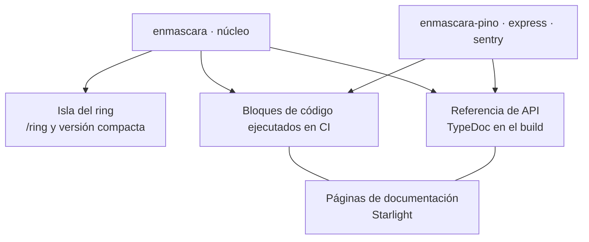

# Enmascara — Plan del Sprint 3

25 de noviembre de 2026

## Resumen

El Sprint 3 dura 2 semanas, del 30 de noviembre al 11 de diciembre de 2026, y termina con el ring y la documentación del sitio construidos en `apps/site`, con la referencia de API generada desde los TSDoc. El sitio todavía no se publica: eso es la historia 11, que necesita dominio y hosting (T3).

Se comprometen 12 puntos, la velocidad medida en los sprints 1 y 2. Son las historias 6, 7 y 8 de la propuesta de `docs/sprint-2.md`, con sus criterios ajustados a la decisión D2.

**Definición de terminado del sprint:** `/ring` y `/docs/` construyen en CI con axe sin violaciones, Lighthouse de 95 o más a 390 y 1440 px y cero peticiones a otros orígenes. Usar el ring no genera ninguna petición ni escribe en el almacenamiento del navegador. Cada bloque de código de la documentación con salida esperada corre en CI contra el paquete construido. Un export sin TSDoc rompe el build. La cobertura queda en 95 % o más y la mutación en verde en el código nuevo fuera de los componentes de Astro.

Siguen vigentes, sin cambios, las secciones Estándares de ingeniería, TDD y Modelo de amenazas de `docs/sprint-1.md`, el modelo de amenazas del sitio de `docs/sprint-2.md` y la sección Sitio web de `CLAUDE.md`. Este documento solo agrega lo nuevo.

## Pendientes del Sprint 2

Se resolvieron el 25 de noviembre, antes de que terminara el Sprint 2:

| Pendiente | Estado | Evidencia |
| --- | --- | --- |
| Arreglo de `enmascara-pino`: serializers antes de enmascarar | Resuelto | PR #38; `enmascara-pino@0.1.1` publicado con provenance (PR #43) |
| `docs/sprint-1.md` (T5) | Resuelto | PR #37. La definición de terminado del Sprint 2 queda cumplida en sus cinco puntos |
| Reservar `enmascara` en PyPI y RubyGems (resto de T1) | Resuelto | PR #40 |
| PRs de Dependabot #30 a #35 | Resuelto | #30 y #31 mezclados; #32 a #35 reemplazados por #39 y #41, que actualizan también el lockfile |
| Lighthouse inestable en CI | Resuelto | PR #42: se evalúa la mediana de tres corridas |
| D2 | Decidido | Ver [Decisiones](#decisiones) |

Siguen abiertos y no bloquean este sprint: el issue #28 con los marcadores del diseño (T2 y T4), D3 y D5 con el dominio (T3). Los tres bloquean historias del Sprint 4.

## Decisiones

| # | Decisión | Estado |
| --- | --- | --- |
| D2 | Candidatos que no pasan la validación en el ring | **Decidido el 2026-11-25: se quitan las filas "Ignorado" y el conteo de "números ignorados" del diseño.** El ring muestra solo lo que el paquete enmascara. Una API de candidatos rechazados se propondría como historia aparte, con su contrato primero en la spec y una fila nueva en el modelo de amenazas, porque esos candidatos no se enmascaran y entregarlos invita a registrarlos en logs |
| D3 | Lista de espera del escáner | Pendiente, antes de la landing (historia 9, Sprint 4). Recomendación sin cambios: sin formulario hasta aprobar un servicio |
| D5 | Hosting del sitio | Pendiente, antes del Sprint 4, junto con el dominio (T3) |
| D6 | Transporte enmascarado de Sentry | Pendiente. Ver [Preguntas abiertas](#preguntas-abiertas) |
| D7 | Adelantar la landing al Sprint 3 | Pendiente. Ver [Preguntas abiertas](#preguntas-abiertas) |

### Preguntas abiertas

**D6. ¿Entra una historia para el transporte enmascarado de Sentry?** Los hooks de `enmascara-sentry` cubren eventos, breadcrumbs, spans, logs, métricas y el encabezado del envelope (ADR 0007). Un transporte enmascarado cubriría además lo que el SDK agregue en versiones futuras por caminos nuevos. Recomendación: no entra en este sprint. Se estima como historia aparte de 3 puntos, con su ADR, y se planea cuando haya un caso real que los hooks no cubran o cuando una versión mayor de `@sentry/node` agregue un camino nuevo. El test de extremo a extremo con el transporte falso ya falla si un identificador del fixture llega sin enmascarar.

**D7. ¿Se adelanta la landing?** Recomendación: no. La landing reutiliza la isla del ring (historia 6), necesita D3 para la lista de espera y su adelanto de Patrocina depende de T2. Adelantarla obligaría a construirla con marcadores y a rehacerla en el Sprint 4. El orden ring, documentación y referencia deja al Sprint 4 la landing, Patrocina y la publicación, cuando T2, T3 y T4 ya deberían estar resueltas.

## Alcance

| Bloque | Puntos | Sprint |
| --- | --- | --- |
| El ring | 5 | 3 |
| Documentación con el diseño | 5 | 3 |
| Referencia de API generada | 2 | 3 |
| **Total comprometido** | **12** | |

### Fuera del Sprint 3

La landing, Patrocina, la publicación del sitio, la gema de Ruby, el paquete de Python, NSS, INE, teléfonos, el CLI y el transporte enmascarado de Sentry. Ninguna historia de este sprint cambia la spec ni la API pública del núcleo.

## Arquitectura

El ring es el primer consumidor del núcleo en el navegador. Es una isla de Astro que importa `enmascara` del workspace; el resto de la página es HTML estático. La documentación sigue en Starlight, y la referencia de API se genera en el build desde los TSDoc de los cuatro paquetes.



### Decisiones de arquitectura

- **El ring no tiene estado fuera de la memoria de la página.** Ni la URL, ni el almacenamiento, ni el portapapeles salvo cuando el usuario pulsa copiar. Recargar la página lo deja vacío.
- **La isla del ring es una sola, con dos presentaciones.** `/ring` usa la completa y la landing (Sprint 4) la compacta. Las dos comparten el mismo módulo y los mismos tests.
- **Cada salida de ejemplo se genera con el paquete real.** Los ejemplos del ring salen de los fixtures de `spec/fixtures/`, y cada bloque de la documentación con salida esperada se ejecuta en CI. Ninguna salida se escribe a mano.

## Riesgos

| Riesgo | Efecto | Mitigación |
| --- | --- | --- |
| El núcleo usa algo que el navegador no tiene | La isla no arranca | El núcleo no importa módulos de Node ni usa `Buffer` o `process` (revisado el 25 de noviembre). Lo primero de la historia 6 es un test de Playwright que enmascara un fixture en el navegador |
| El peso de la isla baja el rendimiento en Lighthouse | Se rompe el mínimo de 95 en móvil | La isla se hidrata con `client:visible` en la versión compacta. El job `site` ya mide la mediana de tres corridas |
| Los catálogos del núcleo en el bundle del navegador | Más kilobytes de JavaScript | Se mide el tamaño del bundle de la isla en el PR y se registra en el ADR de la historia 6 |
| La integración de TypeDoc con Starlight no soporta la versión de Starlight del sitio | La historia 8 crece | Un spike al inicio de la historia 8. Si no es compatible, TypeDoc genera Markdown y Starlight lo sirve como contenido; la decisión queda en un ADR |
| Las integraciones vuelven a destapar defectos del núcleo | Trabajo no planeado, como en el Sprint 2 | Cada defecto lleva su PR con `test:` antes del `fix:`. Si pasan de un día de trabajo, se negocia el alcance de la historia 8 |

## Seguridad

### Modelo de amenazas: nuevas filas

Las filas del ring de `docs/sprint-2.md` (exfiltración, XSS, persistencia y llave de demostración) aplican sin cambios. Estas se agregan:

| Amenaza | Cómo ocurriría | Blindaje | Test que lo prueba |
| --- | --- | --- | --- |
| La tabla de hallazgos revela el valor | La tabla o su texto accesible muestra el identificador detectado | La tabla muestra tipo, línea y resultado enmascarado, nunca el valor | Test que pega cada fixture válido y busca el valor en el DOM fuera de la entrada |
| La entrada termina en la URL | El estado del ring se serializa en la query o el hash para compartirlo | El ring no cambia la URL | Playwright: después de escribir y cambiar opciones, `location.href` es el mismo que al cargar |
| El panel "Lo mismo en tu código" copia la entrada | El fragmento generado incluye el texto pegado | El fragmento se arma solo con las opciones elegidas | Test con una entrada que contiene un identificador: el fragmento no la contiene |
| El ring se usa con una llave real | Alguien pega su llave de producción para probar `hmac` | El ring no acepta llaves; usa siempre la llave pública de demostración | Test de que no existe un campo de llave y de que el aviso aparece con `hmac` |
| Un ejemplo de la documentación filtra datos reales | Un ejemplo usa una CLABE o CURP de una persona | Los ejemplos usan valores de `spec/fixtures/`, que son sintéticos (ADR 0001) | Test que extrae cada identificador de los bloques de código y exige que esté en los fixtures |
| La referencia de API incluye código interno | TypeDoc documenta símbolos no exportados | TypeDoc parte solo de los puntos de entrada públicos de cada paquete | Test de que la referencia no contiene símbolos fuera de los `exports` de cada `package.json` |

## Plan de acción

### Compromiso del Sprint 3

Tres historias, 12 puntos. La semana 1 construye el ring; la semana 2, la documentación y la referencia.

| # | Historia | Semana | Puntos | Criterios de aceptación |
| --- | --- | --- | --- | --- |
| 6 | El ring | 1 | 5 | Página `/ring` según los tableros "El ring" y "El ring · móvil", y la versión compacta para la landing con la misma isla. Un ADR registra cómo se hidrata la isla, el tamaño de su bundle y la llave de demostración. Importa `enmascara` del workspace; un test falla si la isla define validadores o expresiones regulares de detección propias. Ejemplos cargables (log de transferencias, payload JSON y export CSV) con valores tomados de los fixtures de la spec. Selector de tipos, de estrategia (Máscara completa = `redact`, Media máscara = `partial`, Incógnito = `hmac`) y entrada y salida en vivo. Tabla de hallazgos con tipo, línea y resultado enmascarado, nunca el valor, solo con lo que devuelve `findings()`; sin filas "Ignorado" ni conteo de ignorados (D2). Las etiquetas y formatos son los reales del paquete (`[CARD]`, `************1111`). Panel "Lo mismo en tu código" generado con las opciones elegidas. Botón de copiar. Aviso de la llave de demostración con `hmac`. En móvil, los ajustes se pliegan como en el diseño. Playwright prueba cero peticiones y cero almacenamiento al usarlo, que la URL no cambia, que funciona sin conexión después de cargar y las cargas XSS. axe y foco visible en cada control, con objetivos táctiles de 44 px |
| 7 | Documentación con el diseño | 2 | 5 | Starlight con el encabezado, la barra lateral, "En esta página", anterior y siguiente, y "Editar esta página en GitHub" de los tableros "Docs · Inicio rápido" y "Docs · móvil". La versión del encabezado sale de `packages/core/package.json`. Tema claro y oscuro, cuya preferencia es lo único que se guarda en `localStorage`. Pestañas de instalación npm, pnpm y yarn, accesibles con teclado. Páginas: Introducción, Instalación, Inicio rápido, CLABE, CURP (con el estado del ADR 0002), RFC, Tarjetas, las tres estrategias, pino, Express, Sentry, Modelo de amenazas y Reportar una vulnerabilidad. "NSS, INE y teléfonos · próximamente" sin enlace. Cada bloque de código con salida esperada (`→`) se ejecuta en CI contra el paquete construido, como el README. Los ejemplos usan valores de los fixtures, no los del diseño que no validan. `[versión mínima de Node.js]` queda visible mientras el issue #28 siga abierto. Búsqueda con Pagefind según D4 |
| 8 | Referencia de API generada | 2 | 2 | TypeDoc genera la referencia de `enmascara` y de las tres integraciones desde sus TSDoc, dentro de Starlight, partiendo solo de los `exports` de cada `package.json`. El build falla si un export no tiene documentación o si un ejemplo no compila. La tabla de opciones de `createRedactor` del Inicio rápido enlaza a la referencia en vez de repetirla. La referencia pasa axe, la CSP y el test de cero peticiones externas como el resto del sitio |

Total: 12 puntos.

### Propuesta para los sprints 4 a 6

Sin cambios respecto a `docs/sprint-2.md`: Sprint 4 con la landing, Patrocina, la publicación del sitio y la base de la gema (11 puntos); sprints 5 y 6 con la gema de Ruby. Se replanifica al cierre de este sprint con la velocidad medida.

### Tareas del equipo, sin puntos

Necesitan cuentas, pagos o 2FA, así que no las hace Claude Code. Ninguna bloquea el Sprint 3; las tres bloquean el Sprint 4.

- [ ] **T2:** crear GitHub Sponsors y Open Collective y definir los montos de los niveles. Bloquea Patrocina (historia 10).
- [ ] **T3:** registrar el dominio y elegir el hosting (D5). Bloquea la publicación del sitio (historia 11).
- [ ] **T4:** definir el correo de contacto y de reportes de seguridad, y la respuesta sobre CFDI. Bloquea Patrocina y el pie de la landing.

## Handoff a Claude Code

Claude Code trabaja historia por historia en el orden del plan, con un PR por historia. La historia 6 va primero porque es el mayor riesgo técnico. La 8 va después de la 7 porque reemplaza la tabla de opciones del Inicio rápido por un enlace a la referencia.

### Prompt inicial

```text
Lee docs/sprint-3.md, docs/sprint-2.md, docs/sprint-1.md y CLAUDE.md. Vamos a trabajar el Sprint 3 historia por historia.
Sigue TDD en todo: test que falla, código mínimo, refactor, con commits separados.
Empieza con la historia 6 (el ring). Antes de escribir código, muéstrame la estructura de la isla,
cómo se hidrata, qué importa de enmascara y los tests de Playwright que vas a escribir primero.
Cuando la apruebe, impleméntala, corre lint, tests, mutación, axe y Lighthouse, y prepara el PR.
No avances a la historia 7 sin mi visto bueno.
```
